<p align="center">
  
</p>

<p align="center">
  
  
  
  <a href="LICENSE"></a>
</p>

<p align="center">
  <a href="#quick-start"><b>Quick start</b></a> ·
  <a href="SETUP_PROMPT.md"><b>Setup prompt</b></a> ·
  <a href="docs/GETTING_STARTED.md"><b>Checklist</b></a> ·
  <a href="dist"><b>Skill downloads</b></a>
</p>

# Internship Applyer (Claude + Muse)

An AI-agent setup for internship season. Claude finds roles and builds your resumes, Muse applies, and you only step in when something's blocked.


I built this for my own search (538 applications from Aug 1 to Oct 10, 2026, with 9 interview or recruiter-screen invites) and cleaned it up so anyone can set it up. Everything personal has been taken out.

## How it works

```
 Role finder (Claude, daily)          Resume builder (Claude)
 SimplifyJobs GitHub list,            one resume per role type,
 LinkedIn, Indeed, Handshake,         checked against what you've done
 Intern Insider                                  |
          |                                      v
          v                              Candidate kit (private)
   Agent workbook  <---- claims ----  Muse (applies, one role at a time)
   (Google Sheet)                                |
          ^                                      v
          |                            Application Gmail (codes, replies)
          +---- status updates ---- Inbox listener (Claude, daily)
                                                 |
                                                 v
                                  You: Blocked tab, assessments, interviews
```

1. **Role finder** pulls new internships every day, logs them in the workbook's Discovery tab, and queues the ones that match your targets.
2. **Resume builder** turns your master resume into up to 8 one-page resumes, one per role type or industry.
3. **Muse** reads the workbook's Agent Guide, claims a queued role so no other agent touches it, applies with the right resume, and records the result or the exact reason it got blocked.
4. **A separate Gmail** used only for applications catches portal accounts, verification codes and replies.
5. **Inbox listener** reads that Gmail and writes confirmations, assessments, interviews and rejections back to the workbook.
6. **You** handle the Blocked tab, take the assessments and interviews, and spot-check what was submitted.

## What's in here

| Path | What it is |
|---|---|
| [`CLAUDE.md`](CLAUDE.md) | Directions Claude reads automatically when you open this folder in Claude Code, so it runs the setup and interview for you. |
| [`SETUP_PROMPT.md`](SETUP_PROMPT.md) | Paste into Claude. It interviews you, fills in everything, builds your resumes, and walks you through setup on your own computer. **Start here.** |
| [`docs/GETTING_STARTED.md`](docs/GETTING_STARTED.md) | The same setup as a plain checklist, if you'd rather do it by hand. |
| [`workbook/agent-workbook.xlsx`](workbook/agent-workbook.xlsx) | The shared workbook every agent works through: Agent Guide (the rulebook), Discovery, Agent Queue, Agent Activity, Applications, Events, Blocked. Comes with EXAMPLE rows; delete them before you start. |
| [`candidate-kit/`](candidate-kit) | Your private side: standing instructions, profile, common answers, project facts (what you can truthfully claim), resume guide. Only your applying agent gets this. |
| [`skills/role-finder/`](skills/role-finder) | Claude skill plus a tested Python script that reads the SimplifyJobs list and skips roles you already have. |
| [`skills/resume-builder/`](skills/resume-builder) | Claude skill that builds your role-specific resumes in a clean, ATS-friendly format (or your own template). |
| [`skills/inbox-listener/`](skills/inbox-listener) | Claude skill that keeps the workbook up to date from your application inbox. |
| [`guides/muse-gmail.md`](guides/muse-gmail.md) | Connecting your application Gmail and Google Sheets to Muse, plus how to handle portal passwords. |
| [`dist/`](dist) | Ready-to-upload zips of each skill and the candidate kit. |

## Quick start

**With Claude Code (easiest):** clone or download this repo, open the folder in Claude Code, and say "set me up". Claude reads [`CLAUDE.md`](CLAUDE.md) and starts the interview on its own.

**With claude.ai or the Claude desktop app:**

1. Click **Code > Download ZIP** and unzip it.
2. Open Claude (claude.ai, the desktop app, or Claude Code). Attach `workbook/agent-workbook.xlsx`, `dist/candidate-kit.zip` and your master resume (everything you've ever done, any length).
3. Paste in everything below the line in [`SETUP_PROMPT.md`](SETUP_PROMPT.md).
4. Answer Claude's questions. It fills your kit and workbook, builds your resumes, and gives you a step-by-step plan for your computer.
5. Follow the plan with Claude. It checks each step with you before moving on.

## What you'll need

- A Claude account with skills. For the daily runs, use Claude Code or Cowork, because the role finder runs a small Python 3 script and both skills run on a schedule. On claude.ai you can still run everything by hand, and the role finder falls back to job-alert emails.
- [Muse](https://www.meta.com/help/artificial-intelligence/1687253048996149/), Meta's AI agent, for applying, with its **Gmail** and **Google Sheets** connectors turned on. At launch Muse was reported to be US and Canada only.
- A new Gmail just for applications, and a Google account for Sheets. Import the workbook into Google Sheets; the Blocked tab's formula is made for Sheets.
- Accounts on the job boards you want to pull from (Intern Insider, Handshake, Indeed, LinkedIn).

## What it costs

About **$20 a month** total.

| Piece | Cost |
|---|---|
| Claude Pro (includes Claude Code, skills, connectors and scheduled tasks) | $20/month, or $17/month billed yearly |
| Muse | Free. The free tier gives 500 million tokens a week, which is enough to run this, plus referral credits (see below) |
| Gmail, Google Sheets | Free |
| Intern Insider, Handshake, Indeed, LinkedIn | Free accounts |
| This kit | Free (MIT license) |

## Getting Muse (if you don't have it yet)

1. Download Muse on iOS or Android, or go to [muse.ai](https://muse.ai), and sign in.
2. When it asks for a referral code, enter **`5ZLI09`**. You and I each get **1 billion bonus credits** on top of the free tier's 500 million tokens a week.
3. **Want to keep running Muse for free?** Muse's referral program works the same way for you: share your own code, and every person who signs up with it gets 1 billion credits and so do you. That's how I've run all my applications without paying for Muse.
4. Then connect your application Gmail and Google Sheets using [`guides/muse-gmail.md`](guides/muse-gmail.md).

## Ground rules baked into every piece

- **Nothing gets made up.** Every resume line and form answer has to trace back to your master resume, your project facts or your own answers. If something's missing, the agent marks the role blocked and asks you.
- **No double applications.** Agents claim a role before touching it, and nothing marked submitted or uncertain is ever retried.
- **Submitted means confirmed.** Only a confirmation page or receipt email counts.
- **No secrets in files.** Passwords and verification codes never go in the workbook or the kit.
- **You stay in charge.** Read what goes out in your name, at least at the start, and apply to your dream companies yourself.

## Notes

Not affiliated with Anthropic, Meta, Simplify, Intern Insider, LinkedIn, Indeed or Handshake. Follow each site's terms; the role finder reads pages the way you would and prefers job-alert emails over browsing. Found something that breaks? Open an issue.

Built by [Oliver Browne](https://www.linkedin.com/in/olibrowne/).
